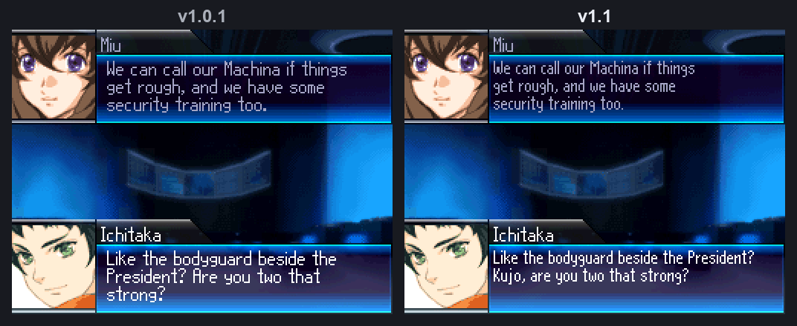
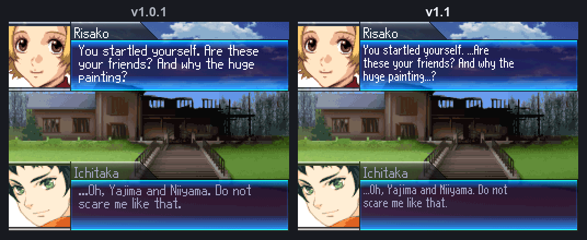
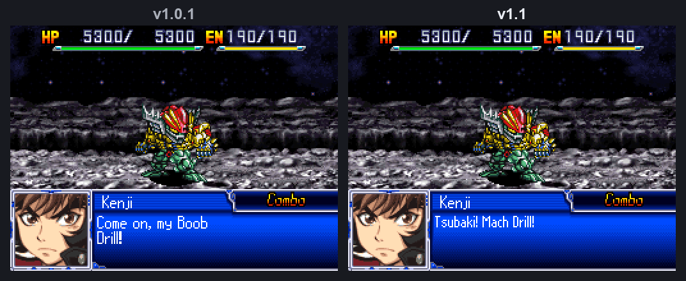
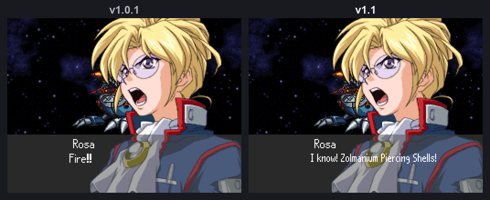
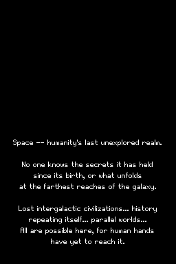
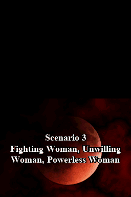
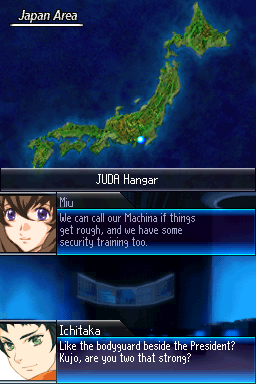
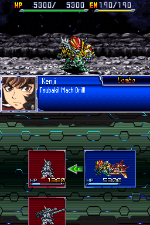
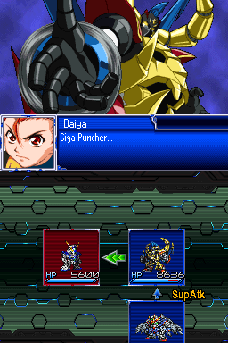

# Super Robot Taisen L -- English v1.1

An unofficial English fan translation for **Super Robot Taisen L** on Nintendo DS. This is a public playtesting release. Only patches (an offline HTML patcher and a .bps), checksums and documentation are distributed; supply your own clean Japanese cartridge dump.

## Introduction
Hello,
I was curious about using AI as a tool in order to translate a SRW game (been a fan for a long time now) and I kept having too much fun working on it while throwing deepseek, Claude, Chatgpt at it to push through every bug and fixes I could find.
In my opinion, using AI to help translate a game is far harder than I thought. While AI makes it easier, a lot of work is just figuring things out and applying solutions and waiting. I spent the past few weeks wrestling with SRW L and seeing bugs and issues crop up one over another.
After playing through it a bit and fixing all the bugs I could spot, I feel like this is good enough for a public release and something I'm proud of putting out into the world. Please do let me know if you find any bugs or issues while playing the game. I would be happy to fix them.

## What's new in v1.1
The big one this time is space. We got a narrower font working in story scenes and battle quotes, so each line holds a lot more text than before. That let us go back through the script and fix the lines we'd had to cut down to make them fit.

- More text fits on each line in story scenes and battle quotes, so far fewer lines get cut short or split in odd places.
- With the extra room we went back over about 2,600 story and battle lines and checked them against the Japanese. Lines that had lost meaning to fit are back to their full wording, and stiff ones read more naturally. Characters also address each other more consistently, and the leftover "-san" in battle quotes is gone.
- Put back the "..." pauses from the Japanese in about 800 lines.
- Fixed battle quotes that showed the wrong line or broke in a weird place, including Kenji's Mach Drill call, Saruwatari's taunt and the "War of the Giants" line.
- Did another name pass, so character and speaker names match the Japanese more closely.
- Intuition and Resupply no longer show up as blank slots on the Pilot Stats page.
- New browser patcher, `SRWL_English_v1.1.html`. It works offline and nothing gets uploaded, so you don't need a separate patching program.

### Before and after
v1.0.1 on the left, v1.1 on the right. Same scene, same save.

### Included from v1.0.1
- **Combination attacks show the right pilots again.** Some battles showed the wrong speaker with an untranslated line, for example Heero during Steel Jeeg's Mach Drill, and left out the yellow Combo label. A long English weapon or unit name could run past a hidden battle slot and change how the game picked the quote. Mach Drill now shows Kenji and Tsubaki with the Combo label, and other battles that picked the wrong quote the same way are fixed too.
- **Combo label no longer cut off.** The yellow label on combination attacks is fully visible again.
- **Pilot names on one line.** Twenty-three enemy and NPC names drawn as pictures were split over two lines, and the speaker box cut off the top line. They now fit on one line: the numbered Angels, EVA Unit 01, SOUND ONLY, NERV Agent and NERV Staff, Neos Gold and Darius XVII keep their names, and seven longer ones are shortened to fit (Unk. Soldr, Logos Man, UN Officer, UN Soldier, Vajra Q., B. Galaxy, MP Machina).
- **Godannar names.** "Go Dannar" is now **Godannar** throughout, and the Go-Okusaer and Neo-Okusaer names now match the Japanese.
- **Clearer list menus.** On the Assigned Units, Pilot Abilities, Unit Stats and Skill Parts lists, column headers now use short labels that fit their columns (S.Atk, S.Def, Arm, Hit, Left), rows with no level keep their columns lined up, and the ability column shows an English marker instead of a Japanese one.

### Included from v1.0
- **Approved battle pop-up artwork.** 95 approved round-3 resources are installed with native geometry, palette, raw-PAT, alias and predecessor guards: Critical pop-ups, Support Attack/Defense badges and banners, map-result pop-ups and the common battle labels. Bronze Bell and the shipped-sans **9 PM Don't Be Late** are included.
- **Battle-name buffer crash fixed.** The weapon, unit and pilot name caches used by battle screens are now bounded copies. Long names are truncated at a character boundary instead of overwriting the adjacent memory, which fixes the crash when Daiku-Maryu used Zolmanium Piercing Shell. No translation or name text was changed.
- **One patch for both dumps**, as in v0.91/v0.92: the same `.xdelta` applies to the canonical dump and the zeroed extended-header dump and produces the same patched ROM.

### Included from v0.92.1
- Fixed garbage font tiles below Skills, Spirits and Abilities descriptions, including Shield Defense in map Search, and the graphics damage that could follow after leaving help.
- Corrected unit identity data: Jack Smith no longer displays Takeminakata; Gaiking no longer displays Godannar. Heavyarms Kai, Dancouga Nova Max God and Quadran with Super Pack also use their correct names.

### Included from v0.92
- **Anti-piracy game over fixed on DS/3DS and flashcarts.** Anti-piracy checks are fully disabled in the patch; no cheat file is needed.
- **English ending credits**, including the Story Outline heading.
- **Weapon and name fixes**, including the Katana/Laser Blade and Ken/Sword splits, Dancou Dangai Sword, Zankitou, Tachi Combo Slash and Heavy Sword.
- **Translated map pop-ups and Iczer graphics**, terrain icons on formation/sortie screens, aligned pilot-stat columns with Hit visible, and corrected sort-heading highlights.
- **Kills/Support Defense pages stay readable** while cycling stats.

### Included from v0.91
- **JIT/dynarec on now works.** The prologue-intro freeze on melonDS Android and WatermelonDS is fixed. There is no emulator setting to disable for this patch.
- **The ROM is 128.5 MB instead of 234 MB.** The English build is tightly repacked; the game content is unchanged, the file is smaller and it loads faster.
- **The remaining Japanese names are translated.** 26 picture-cell/pilot name sources that no text scan could reach now have English names, and Macross Quarter reads exactly "Macross Quarter" in both its fortress and assault states.
- **Enemy and speaker fixes.** The Katou soldier name box is one line, `KATOU ORG. SOLDIER`, and the stray glyph that appeared before Kouichi's speaker name is gone.
- **Cartridge-menu title:** ROM lists show **Super Robot Wars L** in all six banner languages.

## Disclaimer
The game has been translated, including the ending credits, but has not been played from beginning to end on every route. There may still be late-game bugs, rare-menu issues or text overflow. Please report problems with an in-game save and reproduction steps. This remains a public playtesting release; a complete route-by-route hardware playthrough is not claimed.

## Features
- Full English translation of the story, battle quotes, and unit, weapon, pilot and ability descriptions, with a story-wide consistency audit
- Translation has been checked to consistently keep within each series setting, lore and personality to ensure that the writing consistently captured the personality of the characters in the game.
- Official English name spellings for series, characters and mechs where they exist using Akurasu, Fansubs and Wiki as a source
- Terms familiar from other official SRW games like VTX30Y: Will, Valor, Spirit, CQB / RNG / SKL
- Menus and UI fitted to the screen, with labels sized and aligned to match the original layout
- Translated graphics: title and copyright screens, terrain icons, battle badges such as Support Attack
- English cartridge-menu title: **Super Robot Wars L** in all six banner languages
- Battle menu cleaned up: full Action / Counter / Defend / Evade tabs
- JIT/dynarec on is supported on melonDS Android, WatermelonDS and other DS emulators
- 128.5 MB ROM (down from 234 MB), so it loads faster from storage
- All remaining Japanese picture-cell names translated, including Macross Quarter; one-line `KATOU ORG. SOLDIER` label; stray speaker glyph before Kouichi fixed
- Distributed as an offline HTML patcher and a .bps patch: apply it to your own clean Japanese ROM

## Download
Grab `SRWL_English_v1.1.html` (easiest), or `SRWL_English_v1.1.bps` if you prefer your own patcher, plus `CHECKSUMS.txt` from the [v1.1 release](https://github.com/jignx/SRWL-English/releases/tag/v1.1).

No pre-patched ROMs, please don't ask.

## Screenshots
Captured in DeSmuME, showing both Nintendo DS screens at their original resolution. The story and battle shots are from v1.1.

| Title screen | Opening narration |
| --- | --- |
|  |  |

| Scenario title | Story dialogue |
| --- | --- |
|  |  |

| Weapon selection | Attack dialogue |
| --- | --- |
|  |  |

| Pilot cut-in | Battle animation |
| --- | --- |
|  |  |

## What you need
A clean Japanese ROM of the game (BRWJ, revision 0, 134,217,728 bytes). Two dumps are known. The HTML patcher accepts both; the .bps applies to the canonical dump:

| Dump | SHA-256 | CRC32 |
| --- | --- | --- |
| Canonical | `a2b666a294df476688ea40e37b9ef53ed609a65bd4a14013ba730057247d594f` | `1D040BE8` |
| Zeroed extended-header metadata | `1bc8e2e0c3bc93eb10bcc189c829ee028590aa48b7f2e7cdb3a5723ee071f37f` | `82804748` |

They contain identical game data; only 188 bytes of unused extended-header metadata in the first 4 KiB differ. If your dump matches neither, the patch won't apply.

## How to patch
**HTML patcher (easiest, both dumps):**
1. Download `SRWL_English_v1.1.html` and open it in your browser. It works offline and nothing is uploaded.
2. Choose your clean Japanese ROM. The page checks it (restoring trimmed or padded dumps to full size first), patches it, verifies the result and saves `SRWL_English_v1.1.nds`. Use the link on the page if the download doesn't start.

**BPS patch (canonical dump):**
1. Check your ROM's SHA-256 matches the canonical dump above.
2. Apply `SRWL_English_v1.1.bps` to a copy of it with Flips or another BPS patcher.
3. Check the patched ROM against `CHECKSUMS.txt`. It should be 128,452,668 bytes with SHA-256 `d6b89851a743d3526026fc3151df4501abeb022fd9dec5b3f2483e3cf891fcc7` (CRC32 `2D97804E`).

If your dump has the zeroed extended header, BPS patchers will reject it; use the HTML patcher, which fixes the header for you.

Back up your save, then start the game fresh. Don't load old emulator savestates, as they can bring back old text and graphics.

The ROM displays the English ROM-list title. Refresh cached ROM lists after replacing the ROM. For an existing 3DS HOME Menu forwarder, recreate the forwarder from the new ROM to update its stored title.

## Known issues
- The game hasn't been played start to finish on every route yet, so some late-game lines, rare menus or long names may still overflow.
- **Weapon Type line comma (cosmetic):** combination attacks and some other weapon types show a trailing comma, e.g. `CQB, Combo,`. The shared translated type fragment ends with an ASCII comma and the game's list builder does not strip it. Tracked for the next text/UI pass; it does not affect gameplay.
- **Long battle names:** the battle name caches are deliberately bounded since v1.0. Very long weapon, unit and pilot names are truncated at a character boundary on those screens; the underlying name text is unchanged.
- A few long battle lines can still run past the edge of the box. One we know about is Daiya's "Take a good look! We're giving it everything we've got!" in a Gaiking battle.
- Old save states are incompatible with this update; cold boot and load a normal in-game save. In-game saves carry over.

Found something? See [PLAYTESTING.md](release_docs/PLAYTESTING.md), and please attach a save. Changes are in the [changelog](release_docs/CHANGELOG.md).

## Report a bug
Open an issue in the project's issue tracker with a short descriptive title, and include:

- **Version:** the patch version (for v1.1, `SRWL_English_v1.1`) and the patched ROM's SHA-256 from `CHECKSUMS.txt`.
- **Emulator / hardware:** DeSmuME, melonDS, WatermelonDS, 3DS, DS or flashcart, with the exact version, and whether you cold booted.
- **JIT/dynarec:** on or off (and the emulator setting used, if any).
- **What happened:** stage, route choices, speaker or exact menu path, the loaded save slot, expected result and actual result.
- **Reproducible?** always / sometimes / once, with the numbered button and menu steps to repeat it.
- **Screenshot:** both DS screens at native resolution, showing the problem (an English description is fine if you cannot capture one).

If possible, attach a normal battery save near the trigger. Do not upload ROMs or pre-patched games.

## Credits
- Translation and testing: Jignx, with AI help from ChatGPT (Codex), Claude and DeepSeek. Every change was checked in-game by hand.
- Terminology reference: Akurasu
- Fonts: GohuFont by Hugo Chargois (WTFPL), adapted to a proportional font; Roboto Condensed by the Roboto Project Authors (SIL OFL 1.1)
- Tools: DeSmuME, xdelta, BPS

Super Robot Taisen L and all its characters, art and music belong to their respective rights holders. This project isn't affiliated with or endorsed by them. Please don't share ROMs or pre-patched games.
