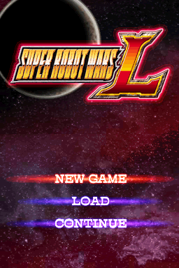
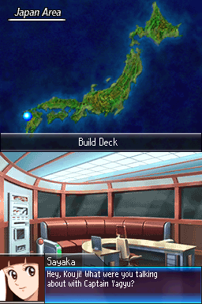
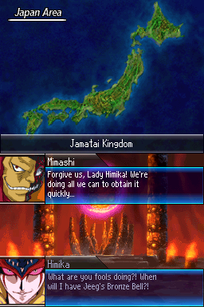
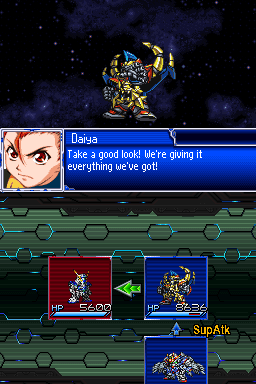
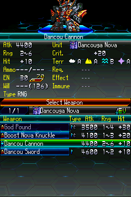
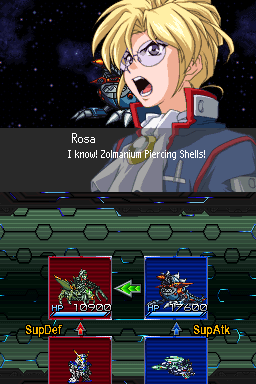

# Super Robot Taisen L -- English v1.1.1

An unofficial English fan translation for **Super Robot Taisen L** on Nintendo DS. Only patches are distributed; you supply your own clean Japanese ROM.

## Introduction
Hello,
I was curious about using AI as a tool in order to translate a SRW game (been a fan for a long time now) and I kept having too much fun working on it while throwing deepseek, Claude, Chatgpt at it to push through every bug and fixes I could find.
In my opinion, using AI to help translate a game is far harder than I thought. While AI makes it easier, a lot of work is just figuring things out and applying solutions and waiting. I spent the past few weeks wrestling with SRW L and seeing bugs and issues crop up one over another.
After playing through it a bit and fixing all the bugs I could spot, I feel like this is good enough for a public release and something I'm proud of putting out into the world. Please do let me know if you find any bugs or issues while playing the game. I would be happy to fix them.

## Features
- Full English translation of the story, battle quotes, ending credits, and unit, weapon, pilot and ability descriptions
- Translation has been checked to consistently keep within each series setting, lore and personality to ensure that the writing consistently captured the personality of the characters in the game.
- Official English name spellings for series, characters and mechs where they exist using Akurasu, Fansubs and Wiki as a source
- Terms familiar from other official SRW games like VTX30Y: Will, Valor, Spirit, CQB / RNG / SKL
- A narrower font in story scenes and battle quotes, so lines keep their full meaning
- Menus fitted to the screen, plus translated graphics: title screen, terrain icons, battle badges and pop-ups
- Anti-piracy checks disabled; JIT/dynarec works on melonDS Android and WatermelonDS

## Screenshots

| | |
| --- | --- |
|  |  |
|  |  |
|  |  |

## What's new in v1.1.1
Cleaner letters in the story and battle font (W, M, Y, T and others redrawn), and about 170 battle quotes that ran past the edge of the box now fit. Older changes are in the [changelog](release_docs/CHANGELOG.md).

## How to patch
You need a clean Japanese ROM of the game (BRWJ, revision 0).

1. Download `SRWL_English_v1.1.1.html` from the [v1.1.1 release](https://github.com/jignx/SRWL-English/releases/tag/v1.1.1).
2. Open it in your browser (works offline, nothing is uploaded), choose your ROM, and it saves `SRWL_English_v1.1.1.nds`.

Prefer your own patcher? Apply `SRWL_English_v1.1.1.bps` with Flips and check the result against `CHECKSUMS.txt`. Dump hashes are in [HEADER_COMPATIBILITY.md](release_docs/HEADER_COMPATIBILITY.md).

Start fresh or load a normal in-game save. Old emulator savestates won't work.

No pre-patched ROMs, please don't ask.

## Compatibility
Tested on New 3DS and Ace3DS+ Wood, plus DeSmuME and melonDS.

## Known issues
- Not every route has been played start to finish yet, so some late-game lines or rare menus may still overflow.
- Some weapon types show a trailing comma, e.g. `CQB, Combo,` (cosmetic).

## Report a bug
Open an issue with the version, emulator or hardware, what happened and how to repeat it, and a screenshot if you can. A save near the problem helps a lot. See [PLAYTESTING.md](release_docs/PLAYTESTING.md). Please don't upload ROMs.

## Credits
- Translation and testing: Jignx, with AI help from ChatGPT (Codex), Claude and DeepSeek. Every change was checked in-game by hand.
- Terminology reference: Akurasu
- Fonts: GohuFont by Hugo Chargois (WTFPL), adapted to a proportional font; Roboto Condensed by the Roboto Project Authors (SIL OFL 1.1)
- Tools: DeSmuME, xdelta, BPS

Super Robot Taisen L and all its characters, art and music belong to their respective rights holders. This project isn't affiliated with or endorsed by them. Please don't share ROMs or pre-patched games.
