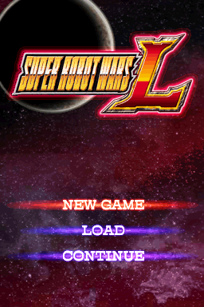
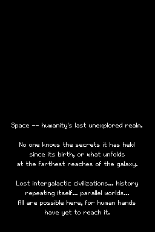
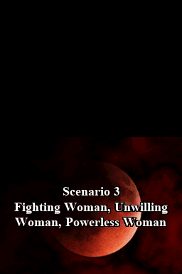
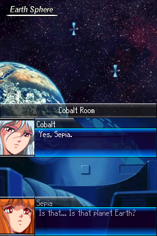
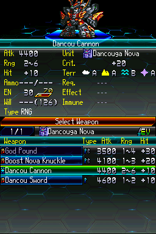
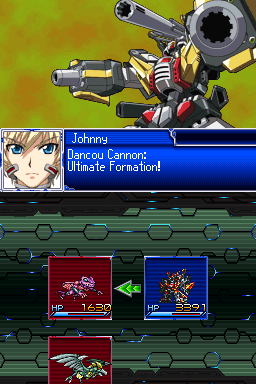
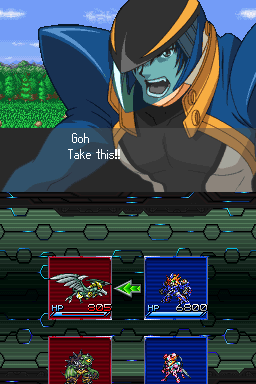
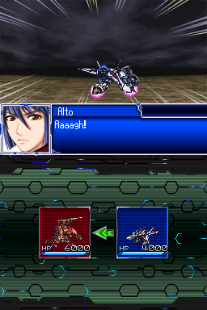

# Super Robot Taisen L -- English v0.9

An unofficial English fan translation for **Super Robot Taisen L** on Nintendo DS. This is a public playtesting release. Only an xdelta patch, checksums and documentation are distributed; supply your own clean Japanese cartridge dump.

## Features
- Full English translation of the story, battle quotes, and unit, weapon, pilot and ability descriptions, with a story-wide consistency audit
- Official English name spellings for series, characters and mechs where they exist
- Terms familiar from other SRW games: Will, Valor, Spirit, CQB / RNG / SKL
- Menus and UI fitted to the screen, with labels sized and aligned to match the original layout
- Translated graphics: title and copyright screens, terrain icons, battle badges such as Support Attack
- Battle forecast cleaned up: full Action / Counter / Defend / Evade tabs, and unit cards that never overflow (long names get short forms on that screen only)
- All 39 BGM titles translated and fitted to the sound menu
- Build-time checks that catch any text that would spill out of its box
- Distributed as an .xdelta patch: apply it to your own clean Japanese ROM

## Download

Get `SRWL_English_v0.9.xdelta` and `CHECKSUMS.txt` from the **v0.9** release on this repository's Releases page. No prepatched ROM is supplied.

## Screenshots

Captured in DeSmuME, showing both Nintendo DS screens at their original resolution.

| Title screen | Opening narration |
| --- | --- |
|  |  |

| Scenario title | Story dialogue |
| --- | --- |
|  |  |

| Weapon selection | Attack dialogue |
| --- | --- |
|  |  |

| Pilot cut-in | Battle animation |
| --- | --- |
|  |  |

## Required clean source

Use a clean, untrimmed, unpatched Japanese ROM, game code **BRWJ**, revision 0.

- Size: **134,217,728 bytes**
- SHA-256: `a2b666a294df476688ea40e37b9ef53ed609a65bd4a14013ba730057247d594f`
- SHA-1: `f97ecb45c0313a44b15fdfed585ef4d5f32c4062`

The updated v0.9 patch also accepts the otherwise-identical dump with zeroed extended-header metadata:

- SHA-256: `1bc8e2e0c3bc93eb10bcc189c829ee028590aa48b7f2e7cdb3a5723ee071f37f`
- CRC32: `82804748`
- Size: **134,217,728 bytes**

Only 188 extended-header bytes differ; the game data is identical. Both sources produce the exact same English ROM. If you encountered **target window checksum mismatch** with this variant, download the updated patch and checksums together from Releases. Do not disable checksum validation.

All source, patch and output hashes are in [CHECKSUMS.txt](CHECKSUMS.txt). Stop if your source matches neither supported hash.

## How to patch

1. Verify your source ROM's SHA-256 against either supported value above.
2. Open an xdelta-compatible patcher such as Delta Patcher. Choose your clean ROM as **Original file** and `SRWL_English_v0.9.xdelta` as **Patch**.
3. Apply to a new output file. Keep your clean ROM unchanged.
4. Verify the patched ROM's SHA-256 and CRC32 against `CHECKSUMS.txt`.
5. Back up your battery save, then cold boot the patched ROM. Avoid loading an old emulator save state after changing patches; it can retain old code and graphics.

Command-line alternative:

```sh
xdelta3 -d -s clean-jp.nds SRWL_English_v0.9.xdelta SRWL_English_v0.9.nds
```

Patched ROM SHA-256: `8caaa39d45c18d532a2b5cb0115bb3dbc0f8487d6fa1d4fca22493b3fab762b2`.

## Validation and known limits

The release patch was applied to fresh copies of both supported ROM headers and independently checked with the published xdelta-wasm web decoder, with checksums enabled. Both results match the build's SHA-256 and CRC32. The build has **0 insertion errors**, passes **12/12 overlay guards** and current engine-source verification, and cold-boots in DeSmuME QA. Narration screenshots match the game's renderer exactly; the history scroll was reached with a native scene-entry fixture.

Standalone tests: **99 modules / 583 tests**. The three known exceptions are `test_engine_source`, `test_spirit_marker_fix` and `test_text_presence`; all other modules pass. The legacy story-fit diagnostic remains at **4,073**, so this is not a claim of zero clipping or a complete route-by-route playthrough.

Some narrow labels, rare UI layouts, long names and alternate routes still need playtesting. The English ending staff roll remains disabled pending genuine ending-continuation verification; boot copyright screens are translated. Hardware and every route have not been comprehensively verified.

See [playtesting and bug reports](release_docs/PLAYTESTING.md) and the [changelog](release_docs/CHANGELOG.md).

## Credits

Thanks to the translation, engineering, editing and playtesting contributors; the Sol and DeepSeek passes; Akurasu for terminology/context; and the emulator, xdelta and font authors. This project used AI assistance, including Codex, Claude and DeepSeek, with human review and playtesting. The two narration replacements are newly translated from Japanese.

Font acknowledgements: GohuFont by Hugo Chargois (WTFPL), with a project proportional adaptation; Roboto Condensed by the Roboto Project Authors (SIL Open Font License 1.1), used for raster lettering. Original game, artwork, music and character rights belong to their respective rights holders. This project is not affiliated with or endorsed by those rights holders.

Do not upload or redistribute source/patched ROMs or original game assets.
