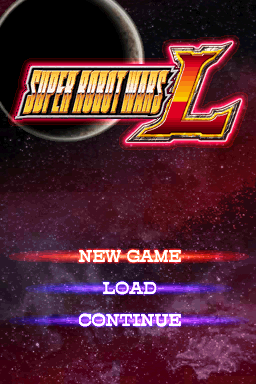
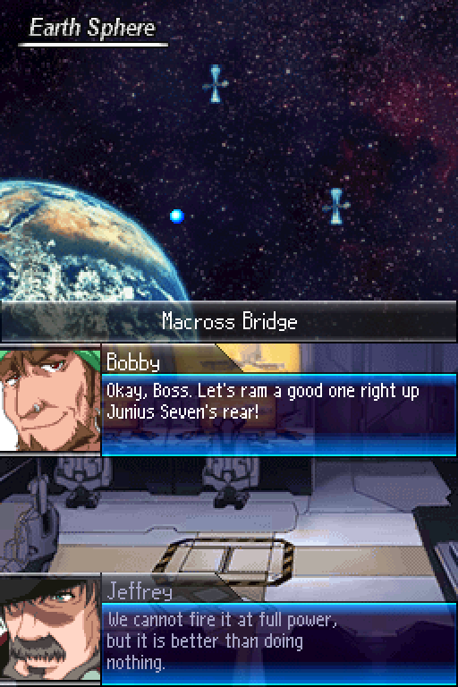
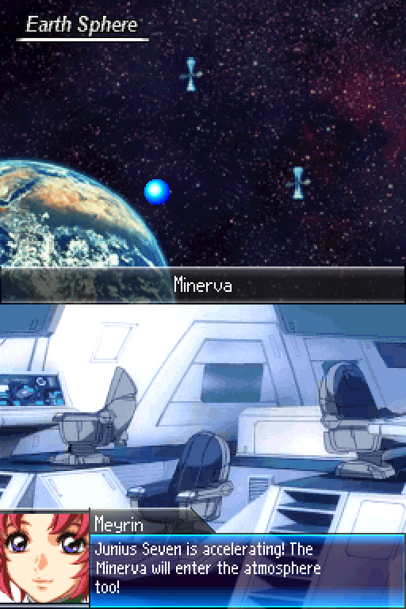
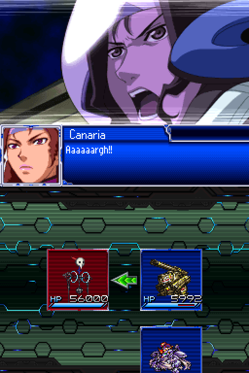
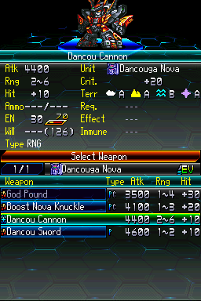
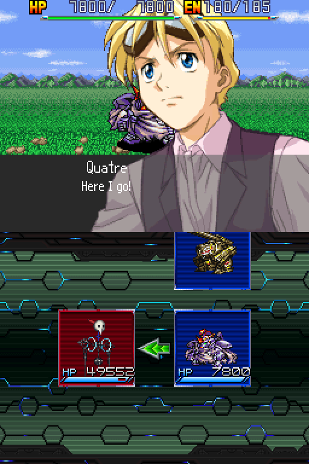

# Super Robot Taisen L -- English v1.4

An unofficial English fan translation for **Super Robot Taisen L** on Nintendo DS. Only patches are distributed; you supply your own clean Japanese ROM.

## Introduction
Hello,
I was curious about using AI as a tool in order to translate a SRW game (been a fan for a long time now) and I kept having too much fun working on it while throwing deepseek, Claude, Chatgpt at it to push through every bug and fixes I could find.
In my opinion, using AI to help translate a game is far harder than I thought. While AI makes it easier, a lot of work is just figuring things out and applying solutions and waiting. I spent the past few weeks wrestling with SRW L and seeing bugs and issues crop up one over another.
After playing through it a bit and fixing all the bugs I could spot, I feel like this is good enough for a public release and something I'm proud of putting out into the world. Please do let me know if you find any bugs or issues while playing the game. I would be happy to fix them.

## Features
- Full English translation of the story, battle quotes, ending credits, and unit, weapon, pilot and ability descriptions
- Translation has been checked to consistently keep within each series setting, lore and personality to ensure that the writing consistently captured the personality of the characters in the game.
- Official English name spellings for series, characters and mechs where they exist using Akurasu, Fansubs and Wiki as a source
- Terms familiar from other official SRW games like VTX30Y: Will, Valor, Spirit, CQB / RNG / SKL
- A narrower font in story scenes and battle quotes, so lines keep their full meaning
- Menus fitted to the screen, plus translated graphics: title screen, terrain icons, battle badges and pop-ups
- Anti-piracy checks disabled; JIT/dynarec works on melonDS Android and WatermelonDS

## Screenshots

| | |
| --- | --- |
|  |  |
|  |  |
|  |  |

## What's new in v1.4
Bug fixes and small menu fixes; the script is the same as v1.3.2. Fixed bugs from the original game: Aoi's A.Combo level on maps, the Great Booster's ammo with B-Save, Spirits staying active after a support attack, Combo attacks started from the target list, and the Dannar Combination cut-in showing Goh instead of Shizuru. Also: enemy info screen labels, a horizontal line in battle with the BGM add-on, the Counter Settings button and help text, Upgrade screen labels, and a stray dot in the weapon list. Full list in the [v1.4 release notes](release_docs/RELEASE_v1.4.md). Re-patch from your Japanese ROM; your saves keep working. If you use a BGM add-on, use the v1.4 add-on (earlier add-ons don't fit v1.4).

## What's new in v1.3.2
Fixes a crash in Stage 12: opening the info screen of the ARMA enemy unit (where its pilot's name is shortened to fit) could freeze or crash the game. Text and graphics are otherwise the same as v1.3.1. Re-patch from your Japanese ROM; your saves keep working. If you use a BGM add-on, use the v1.3.2 add-on (the v1.3.1 add-ons don't fit v1.3.2).

## What's new in v1.3.1
Fixes a freeze on the Saving screen when using the Stereo or Mono BGM add-on; the main patch is unchanged. If you use an add-on, re-patch with the v1.3.1 add-on (your v1.3 ROM or the Japanese ROM both work in the HTML patcher). Your saves keep working.

## What's new in v1.3
A dialogue and presentation pass: about 185 lines corrected for meaning and 380 polished for flow, full names on maps and area titles, and Mission Objectives that name the pilot they need. New: an optional vocal BGM add-on (stereo, with a mono fallback). Older changes are in the [changelog](release_docs/CHANGELOG.md).

## How to patch
You need a clean Japanese ROM of the game (BRWJ, revision 0).

1. Download `SRWL_English_v1.4.html` from the [v1.4 release](https://github.com/jignx/SRWL-English/releases/tag/v1.4).
2. Open it in your browser (works offline, nothing is uploaded), choose your ROM, and it saves `SRWL_English_v1.4.nds`.

Prefer your own patcher? Apply `SRWL_English_v1.4.bps` with Flips and check the result against `CHECKSUMS.txt`. Dump hashes are in [HEADER_COMPATIBILITY.md](release_docs/HEADER_COMPATIBILITY.md).

Optional vocal BGM: in the HTML patcher, also pick `SRWL_English_v1.4_StereoBGM_addon.bps` (or the smaller `SRWL_English_v1.4_MonoBGM_addon.bps`) and it builds the BGM ROM in one go. It also works on an already-patched `SRWL_English_v1.4.nds`. Flips works too. The add-on files are downloaded separately from the GitHub release; download links will be added here shortly. The ROM grows to about 266 MB (stereo) or 197 MB (mono).

Start fresh or load a normal in-game save. Old emulator savestates won't work.

No pre-patched ROMs, please don't ask.

## Compatibility
Tested on New 3DS, Ace3DS+ Wood, SuperCard and DSpico, plus DeSmuME and melonDS. The stereo BGM add-on was tested on 3DS.

## Report a bug
Open an issue with the version, emulator or hardware, what happened and how to repeat it, and a screenshot if you can. A save near the problem helps a lot. See [PLAYTESTING.md](release_docs/PLAYTESTING.md). Please don't upload ROMs.

## Credits
- Translation and testing: Jignx, with AI help from ChatGPT (Codex), Claude and DeepSeek. Every change was checked in-game by hand.
- Terminology reference: Akurasu
- Fonts: GohuFont by Hugo Chargois (WTFPL), adapted to a proportional font; Roboto Condensed by the Roboto Project Authors (SIL OFL 1.1)
- Tools: DeSmuME, xdelta, BPS

Super Robot Taisen L and all its characters, art and music belong to their respective rights holders. This project isn't affiliated with or endorsed by them. Please don't share ROMs or pre-patched games.
