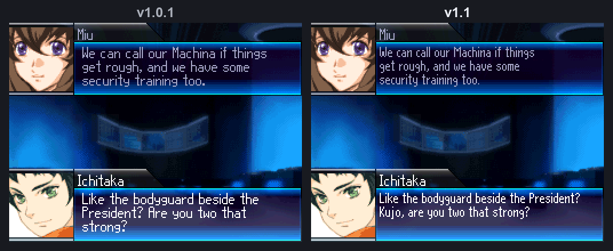
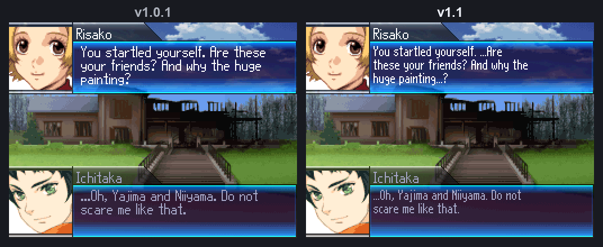
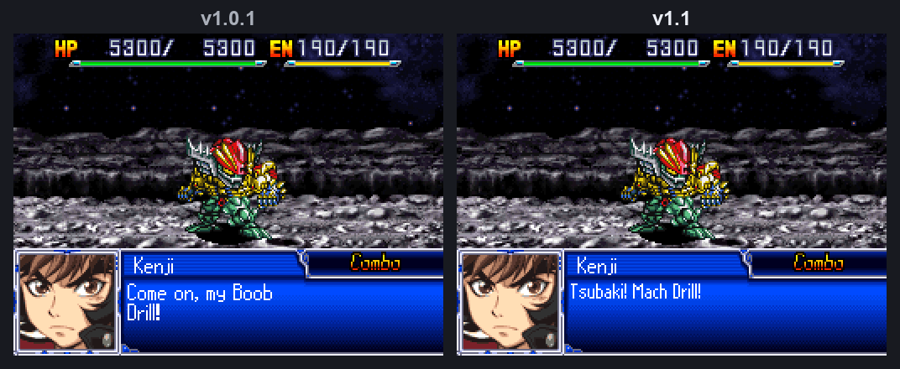
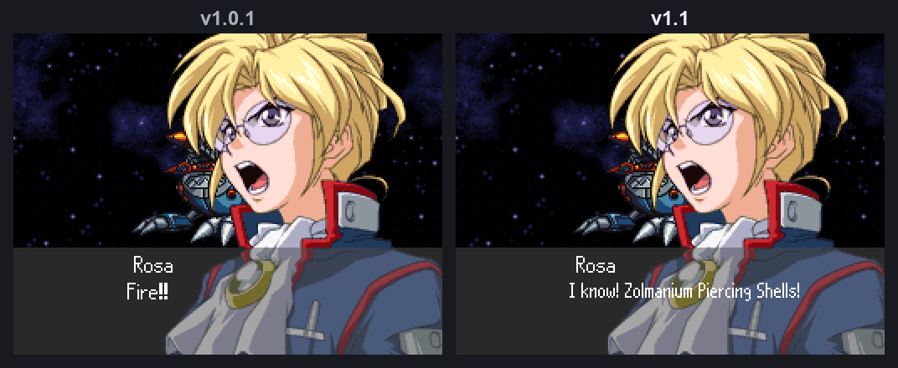

## v1.1

The big one this time is space. We got a narrower font working in story scenes and battle
quotes, so each line holds a lot more text than before. That let us go back through the script
and fix the lines we'd had to cut down to make them fit.

You can also patch in your browser now, so you don't need a separate patching program.

### What changed

- More text fits on each line in story scenes and battle quotes, so far fewer lines get cut
  short or split in odd places.
- With the extra room we went back over about 2,600 story and battle lines and checked them
  against the Japanese. Lines that had lost meaning to fit are back to their full wording, and
  stiff ones read more naturally. Characters also address each other more consistently, and the
  leftover "-san" in battle quotes is gone.
- Put back the "..." pauses from the Japanese in about 800 lines.
- Fixed battle quotes that showed the wrong line or broke in a weird place, including Kenji's
  Mach Drill call, Saruwatari's taunt and the "War of the Giants" line.
- Did another name pass, so character and speaker names match the Japanese more closely.
- Intuition and Resupply no longer show up as blank slots on the Pilot Stats page.
- New browser patcher, `SRWL_English_v1.1.html`. It works offline and nothing gets uploaded.

### Before and after (v1.0.1 on the left, v1.1 on the right)

### How to patch

**In your browser (easiest)**
1. Get your own clean Japanese dump of Super Robot Taisen L.
2. Download `SRWL_English_v1.1.html` below and open it. It works offline.
3. Pick your Japanese ROM. The page checks it, patches it and saves `SRWL_English_v1.1.nds`.
   Both known dumps work, and trimmed dumps get restored to full size first.

**With a BPS patcher**
1. Use the clean dump with the canonical header (SHA-256 `a2b666a2…`, below).
2. Apply `SRWL_English_v1.1.bps` with Flips or any other BPS patcher.
3. The patched ROM should be 128,452,668 bytes and match the SHA-256 below.

If your dump has the zeroed extended header (`1bc8e2e0…`), use the browser patcher. It fixes the
header for you, and BPS patchers will reject that dump.

Back up your save and cold boot. Old save states won't work, but normal in-game saves carry over.

### Known issues

- Combination attacks and a few other weapon types show an extra comma on the Type line
  (`CQB, Combo,`). It's only cosmetic.
- Very long weapon, unit and pilot names get cut short on battle screens. That's on purpose:
  it stops crashes and wrong quotes. They show in full everywhere else.
- A few long battle lines can still run past the edge of the box. One we know about is Daiya's
  "Take a good look! We're giving it everything we've got!" in a Gaiking battle.
- Nobody has played every route start to finish yet, so some late-game lines, rare menus or
  long names may still overflow.

### Found a bug?

Please [open an issue](https://github.com/jignx/SRWL-English/issues) with the patch version, your
emulator or hardware, where it happened (stage, menu or battle), how to make it happen again and
a screenshot of both screens. A normal in-game save near the problem helps a lot. The full
checklist is in [PLAYTESTING.md](https://github.com/jignx/SRWL-English/blob/main/release_docs/PLAYTESTING.md).
Please don't upload ROMs.

### Checksums

- Canonical source SHA-256: `a2b666a294df476688ea40e37b9ef53ed609a65bd4a14013ba730057247d594f`
- Alternate-header source SHA-256 (browser patcher only): `1bc8e2e0c3bc93eb10bcc189c829ee028590aa48b7f2e7cdb3a5723ee071f37f`
- BPS patch SHA-256: `dfa59203a10abc991bb7513aa96dcfba07769131efae0b70f7df6aff967a879c`
- Patched output SHA-256: `d6b89851a743d3526026fc3151df4501abeb022fd9dec5b3f2483e3cf891fcc7`

Only the patchers and checksums are attached. You need your own clean Japanese dump.
