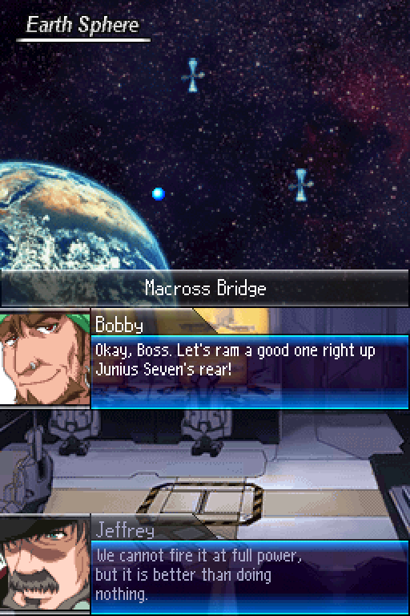
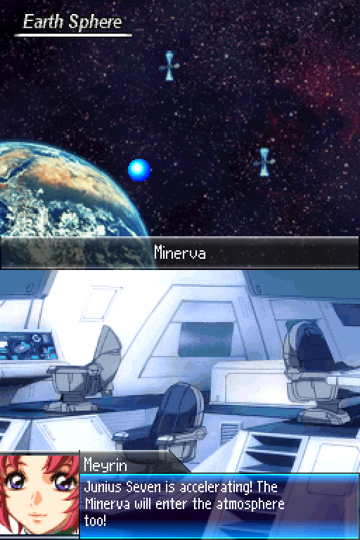
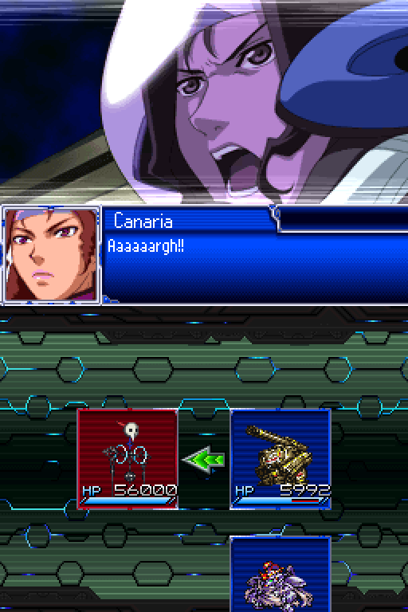
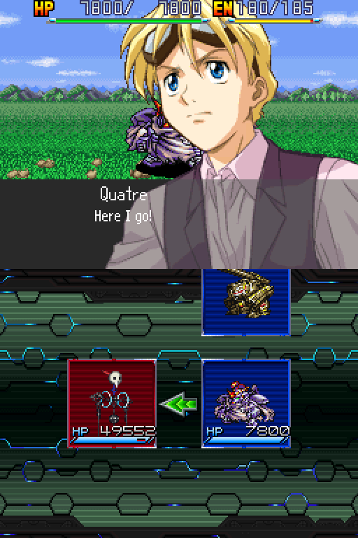

## v1.2

A big text update. We went back over the whole script for meaning and character voice. We also made names and terms consistent, fixed more battle quotes, and added a few in-game helpers.

### What changed

- Better meaning and voice: lines that drifted from the Japanese were fixed, and about 2,200 story lines got a voice pass so each character sounds like themselves.
- Names and terms (Alliance, NUNS, S.M.S., characters, units, weapons) now read the same everywhere.
- More than 200 battle quotes fixed, and the last ones running off the box now fit.
- The Mission Objective screen now hints at secret conditions and route splits.
- Smaller fixes: full place names on the map, the Nagisa sub-pilot bug, BGM titles and UI labels. The DSpico fix from v1.1.2 stays in.

### Screenshots

### How to patch

Same as before: open `SRWL_English_v1.2.html` in your browser and pick your Japanese ROM, or apply `SRWL_English_v1.2.bps` to the clean dump with the canonical header. Both work from the Japanese ROM, so you don't need an earlier version first.

Back up your save and cold boot. Saves from v1.1 and later carry over.

### Known issues

- Combination attacks and a few other weapon types show an extra comma on the Type line (`CQB, Combo,`). It's only cosmetic.
- On a few screens a small button badge touches the label next to it, like the X before Skill Parts and SEL before View. It's only cosmetic.
- Very long weapon, unit and pilot names get cut short on battle screens on purpose.
- Nobody has played every route start to finish yet, so some late-game lines, rare menus or long names may still overflow.

### Found a bug?

Please [open an issue](https://github.com/jignx/SRWL-English/issues) with:

- the patch version
- your emulator or hardware
- where it happened (stage, menu or battle)
- how to make it happen again
- a screenshot of both screens

A normal in-game save near the problem helps a lot. Please don't upload ROMs.

### Checksums

- Canonical source SHA-256: `a2b666a294df476688ea40e37b9ef53ed609a65bd4a14013ba730057247d594f`
- Alternate-header source SHA-256 (browser patcher only): `1bc8e2e0c3bc93eb10bcc189c829ee028590aa48b7f2e7cdb3a5723ee071f37f`
- HTML patcher SHA-256: `be69b111989e7f67893c68b060e9ecf0f1e5fd807b92d53700a46b52cee48502`
- BPS patch SHA-256: `70a63f6cf2ec66f39e66964af3c9c4d33d23928e5b6bce16f737bed083c95715`
- Patched ROM: 128,463,420 bytes
  - SHA-1 `201fab8613eb586e8a6192f047d34143b7eb4f8d`
  - SHA-256 `164570786f29e70785e23f0837437c966c90de068241bcae4e6c8f4936993f52`
